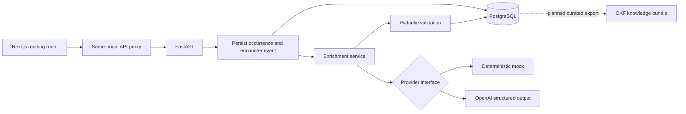

# Margin Memory

AI-powered personal semantic memory for language learning, combining knowledge graphs, contextual vocabulary capture, and agentic AI to turn unfamiliar words into active vocabulary.

Reading in another language should not mean choosing between staying with a
story and remembering new vocabulary. Margin Memory combines a quiet reading
timer, fast word capture, and contextual explanations with a durable record of
where each word was encountered. English → Russian is the first supported pair.

**Status: milestone 1, local single-user MVP.** This is a functional application,
not a hosted service. See [verification](docs/verification.md) for checks actually
run and current limits. GraphRAG, personalized learning and a production OKF
exporter are future work.

The **Semantic Atlas foundation** is also implemented: open
[the Atlas](http://localhost:3000/atlas) from the reading-room navigation. It has
WebGL Network, domain-grouped Clusters, and one/two-hop Orbit views over real
reader-scoped data. See [ontology, architecture and research plan](docs/semantic-atlas.md).

The personal Atlas defaults to meanings and topics, with word identities and
phrases available as an optional layer. It checks for changes every 15 seconds
while visible and when you return to the tab. Case/spacing variants of domain
names share a hub. **Suggested connections** compares stored synonym and antonym
hints with saved meanings; compare both definitions before accepting. Suggestions
stay outside the graph until accepted, and dismissals are remembered. Viewing
the graph and reviewing suggestions do not make additional AI calls.

## What is implemented

- Responsive reading room with source creation/selection and 1–240 minute sessions.
- Deadline-based timer restored from the API on reload; no claims of blocking other phone apps.
- Text capture and opt-in browser speech recognition, with an always-available text fallback.
- Capture committed before enrichment; failures remain saved and can be retried.
- OpenAI structured-output adapter and deterministic, credential-free mock provider.
- Saved encounters with definitions, translations, candidate meanings, context and source.
- Meaning review: confirm a candidate for one encounter, change it, or clear the
  choice. Reader choices are distinguished from unreviewed provider suggestions.
- Semantic Atlas: distinct sense/lexeme/domain/collocation nodes, search, filters,
  node details, zoom/pan, paths, and evidence-bearing reader-created sense links.
- A separate reproducible 486-node demonstration. Its topology is synthetic and
  never inserted into your reading history. It demonstrates scale, not accuracy.
- Lexemes separated from senses, multilingual translation records, typed relationship schema.
- Alembic migrations, backend integration tests, frontend tests, CI and synthetic OKF examples.

Mock mode knows **mitigate, alleviate, exacerbate, yield**. Unknown words are saved
as unresolved with no fabricated definition. Mock mode does not disambiguate
context. It demonstrates the complete persistence flow without paid credentials.

## Architecture



The frontend never holds the OpenAI key. Shared lexical records are separate from
private occurrences. Candidate synonyms are not automatically promoted to graph
edges. More: [architecture](docs/architecture.md), [schema](docs/data-model.md).

## Stack

Next.js 16.4, React 19.3, TypeScript 7, Tailwind 4.3; Python 3.12+, FastAPI 0.143,
Pydantic 2.14, SQLAlchemy 2.1, Alembic 1.20, PostgreSQL 17 and OpenAI Python SDK
3.29. Direct versions were checked against package registries on 2026-10-12.
The frontend has a pnpm lockfile. Backend direct dependencies are pinned;
transitive Python dependencies are not yet locked across platforms.

## Run with Docker Compose

Prerequisites: start Docker Desktop (or Docker Engine with Compose v2+).
On a fresh checkout, Python 3 is used only to generate a private `.env` file using
the standard library. Application Python and Node run inside containers.

```sh
./scripts/dev.sh
```

The helper locates Docker Desktop on macOS even when `docker` is absent from your
shell PATH, creates `.env` with a cryptographically random database password if
needed, builds the images, applies migrations, and waits for healthy services.
It never replaces an existing `.env` or displays the password. Mock AI mode is the
default. Open [the reading room](http://localhost:3000) and
[API documentation](http://localhost:8000/docs).

```sh
./scripts/dev.sh status  # service health
./scripts/dev.sh logs    # recent logs, then follow; Ctrl-C stops following
./scripts/dev.sh stop    # stop the app, retaining its data
./scripts/dev.sh         # start it again
```

Equivalent direct setup, if `docker` is already on PATH:

```sh
python3 scripts/setup-env.py
docker compose up -d --build --wait
```

PostgreSQL data lives in a named Docker volume and survives container recreation.
Do not change the existing database password by editing `.env` alone: PostgreSQL
initializes its password only when the volume is first created. Stop normally
with the helper or `docker compose down`; `docker compose down -v` deletes data.
The services use `restart: unless-stopped`, so they resume when Docker starts
unless you explicitly stopped them. Docker Desktop itself must be running.

The full Docker setup was verified on Apple Silicon with PostgreSQL 17, Python
3.12 and Node 22. The installed host Python 3.15 is not used for API dependencies;
those have not been verified against 3.15. Host Node 24 is also unnecessary for
the Docker route. API and web ports bind only to loopback; the database has no
host-published port. This is local development, not a production deployment.

## Run without Docker

For quick development, SQLite is supported as a convenience database. PostgreSQL
is the intended deployment database; CI includes a separate PostgreSQL test run.
Use Python 3.12 (the verified version) and Node 22+ with pnpm 11.25.0.
If `python3 --version` reports 3.15, use Docker or explicitly install/select
Python 3.12 for this optional native route; do not reuse a virtual environment
created with another Python version.

From the repository root:

```sh
python3.12 -m venv .venv
. .venv/bin/activate
pip install -e 'services/api[dev]'
cd services/api
alembic upgrade head
uvicorn app.main:app --reload --host 127.0.0.1 --port 8000
```

In another terminal, from the repository root:

```sh
cd apps/web
pnpm install --frozen-lockfile
pnpm dev
```

The development command uses Webpack with polling for compatibility with restricted macOS file watchers. The production build uses Next.js defaults.

The API defaults to an ignored `services/api/memory.db` file. For an existing
PostgreSQL database, export `DATABASE_URL=postgresql+psycopg://...` before both
Alembic and Uvicorn. Never put real connection credentials in documentation.

1. Add a source such as “An invented journey”.
2. Select 15 minutes and begin reading.
3. Capture `mitigate`, optionally adding a synthetic sentence.
4. Try `yield` to see separate possible meanings.
5. Open **Your words** to see durable encounters; repeat a word to preserve its
   new context without duplicating an identical lexical sense.
6. Select **Choose this meaning** under the intended meaning. Your choice is saved
   for that encounter and marked **Your chosen meaning**. Choose another meaning
   to change it, or **Clear choice — I’m unsure** to leave it undecided. Reviewing
   a meaning makes no AI request and does not alter other encounters or shared definitions.
7. Open **Semantic Atlas**. Select a meaning to inspect its source and candidate
   classifications. Choose a target, relationship type and evidence to save a
   reviewed connection. Rejected connections retain their evidence but leave the
   visible graph. On narrower screens, **Index** and **Details** open the panels.
8. Select the **Demonstration** collection to explore hundreds of synthetic nodes.
   Use Network / Clusters / Orbit, the name controls and zoom/reset buttons.
   New vocabulary appears automatically (up to 15 seconds while visible), or use
   **Refresh**. No Atlas operation calls AI.

Domain grouping is not community detection. Node size shows connectivity, not
importance or mastery. The Atlas does not yet predict forgetting, assign CEFR,
infer knowledge gaps, import WordNet, or implement Memory/Evolution/Frontier views.
Reduced-motion settings stop force animation; the node index remains usable if
WebGL is unavailable. The full-screen visual direction was informed by the
user-supplied [BL00D.MONEY reference](https://bl00d.money/), using original code and
Margin Memory data, without importing that site's content or assets.

## Configuration

| Variable | Purpose | Default |
| --- | --- | --- |
| `POSTGRES_PASSWORD` | Compose local database password; alphanumeric avoids URL escaping | Required in Compose |
| `DATABASE_URL` | API SQLAlchemy connection URL | Local SQLite |
| `AI_PROVIDER` | `mock` or `openai` | `mock` |
| `OPENAI_API_KEY` | Server-side API credential | Empty |
| `OPENAI_MODEL` | Structured-output-capable model available to your account | `gpt-4o-mini` |
| `API_INTERNAL_URL` | Next.js build-time API proxy destination | `http://127.0.0.1:8000` |

For real enrichment, obtain an API key from your OpenAI API account, then run:

```sh
python3 scripts/configure-openai.py
./scripts/dev.sh
```

The helper prompts without displaying the key, preserves your database password,
and enables OpenAI in the ignored root `.env`. API usage is billed separately
from ChatGPT. The interface shows AI mode; configuration, access, quota and
temporary errors leave the word saved with a retry button. Previously unresolved
mock words can be explained using **Explain with AI** without another encounter.

For non-Docker development,
export these variables in the API terminal or place them in an ignored
`services/api/.env`. The root `.env` is not automatically loaded by that command.
Only the captured text and optional context are sent to OpenAI; source titles and
reading history are not sent. `store=False` is requested. Provider data policies
still apply. Live English–Russian explanations and persistence were verified on
2026-10-13 using synthetic text. These checks do not establish translation quality
across arbitrary words. Generated meanings and relationships remain unverified.

Speech recognition starts only on a button tap and stops after a result or error.
Availability depends on browser, secure context and microphone permission; a
browser may send audio to its own speech service. Mobile layout does not imply
that a phone can reach this loopback-only development server. Use a secured,
authenticated deployment or carefully configured private development tunnel for
phone testing. There is no continuous microphone recording.

## Tests

```sh
# Activated Python environment, from services/api:
pytest -q
alembic check

# From apps/web:
pnpm test
pnpm build
pnpm typecheck
```

Integration tests apply and roll back the real migration. To run them against
PostgreSQL, set `TEST_DATABASE_URL` to a **dedicated disposable test database**;
the fixture downgrades it to base after each test. Never point tests at your
reading database. The workflow is configured to run both SQLite and PostgreSQL tests, frontend
tests, the production build, and TypeScript checks after publication.

## Data and privacy boundaries

This version uses one seeded local reader and has **no login or public-deployment
security**. Compose binds app ports to loopback and does not publish the database
port. Public deployment requires authentication, authorization on every query,
CSRF/origin protections as appropriate, rate limits, secret management, TLS,
backup/restore testing, deletion/export controls and database hardening.

The repository contains synthetic examples only. `.env`, database files, caches
and installed dependencies are ignored. Review staged files before publication.
Open-source code publication is separate from exposing a running application.

## Repository guide

- `apps/web/`: reading interface, browser voice adapter, API proxy and frontend tests.
- `services/api/`: API routes, schemas, models, provider adapters, migrations and tests.
- `knowledge/okf/`: synthetic OKF v0.2 bundle; not a private database export.
- `docs/`: architecture, schema, roadmap, evaluation and publication instructions.
- `.github/workflows/ci.yml`: automated SQLite/PostgreSQL and frontend checks.
- `AGENTS.md`: conventions for future contributions.

## Next milestones

See [roadmap](docs/roadmap.md). Planned work includes reviewed sense linking,
curated OKF export, pgvector-backed hybrid retrieval, bounded GraphRAG, Google
ADK tools, vocabulary activation exercises, predictive retention models, reading
recommendations and BigQuery Graph experiments. None are claimed as implemented.

[Evaluation plan](docs/evaluation-plan.md) defines translation/disambiguation
quality, latency, data integrity and eventual learning-outcome measures.
[Publication notes](docs/publication.md) describe the preserved Git histories and source-only publication.

Repository: [azizarenner/margin-memory](https://github.com/azizarenner/margin-memory).
Automated checks: [GitHub Actions](https://github.com/azizarenner/margin-memory/actions).

## References and license

- [OpenAI structured outputs](https://developers.openai.com/api/docs/guides/structured-outputs): structured response validation used by the adapter.
- [Canonical OKF specification](https://github.com/GoogleCloudPlatform/open-knowledge-format/blob/main/SPEC.md): v0.2 reviewed before producing the sample bundle.

MIT licensed. Contributions should include focused tests and honest documentation.
