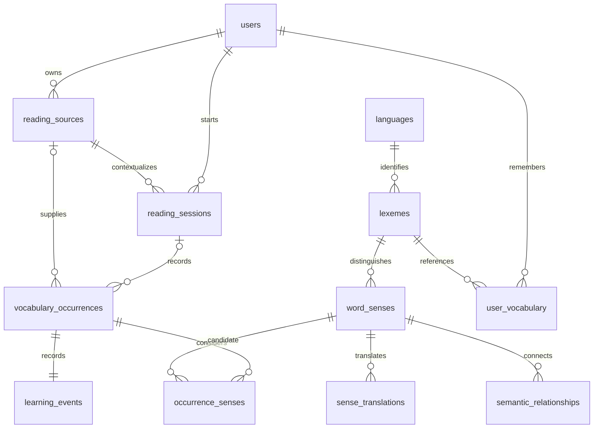

# Relational data model

All record IDs are UUID strings, with UTC creation timestamps. Language codes
are stable text keys. Every association is represented by a foreign key except
historical enrichment snapshots, which are JSON. SQLite is a development fallback;
PostgreSQL is the primary target.

| Table | Role and constraints |
| --- | --- |
| users | Local reader now; identity boundary for later authentication. |
| languages | Extensible language catalog, seeded with en and ru. |
| reading_sources | Reader-owned title; unique user/title pair. |
| reading_sessions | Reader and source, creation time, deadline and optional end time. |
| lexemes | Shared language + lemma; unique pair. |
| word_senses | Shared meaning, part of speech, original generated example and provenance; unique lexical fingerprint. |
| sense_translations | Sense + target language + translation; avoids making Russian a schema-wide assumption. |
| vocabulary_occurrences | Private captured text, optional original sentence, source/session links, request hash, enrichment state and private snapshot. |
| occurrence_senses | Many-to-many association between an encounter and its possible meanings. |
| user_vocabulary | Unique user/lexeme pair and initial encountered stage; not a claim of mastery. |
| semantic_relationships | Unique from-sense/to-sense/type, distinct endpoints, review status and provenance. |
| learning_events | One initial encounter event per capture. Recall/practice event types require later schema evolution. |

A repeated capture creates a fresh occurrence and learning event; it reuses the
same lexeme and identical sense fingerprints. `selected_sense_id` is nullable:
ambiguity is representable without assigning a false meaning. Source/session
consistency and local ownership are checked in the service. Multi-user security
must enforce these constraints for authenticated users and revisit database
ownership constraints; changing the local user constant is not authentication.

`reviewed_at` is set only when the reader explicitly chooses a candidate. Existing
provider-selected IDs remain suggestions with a null review timestamp. Clearing
a choice clears both fields. The original enrichment JSON, including its
`selected_index`, remains an immutable provider snapshot; API clients use the
top-level `selected_sense_id` and `reviewed_at` for current selection. The selection
endpoint locks the owned occurrence and checks candidate membership before writing.
Repeated identical choices preserve the timestamp. This stores the current review,
not a full history of edits or a claim that the underlying definition is verified.

The root migration contains explicit schema operations and seed records, not
imports of mutable application metadata. Tests upgrade and downgrade it. Use
`alembic revision --autogenerate -m '...'`, review the generated revision, then
`alembic upgrade head` for subsequent changes. Do not modify an applied migration.

No embeddings are stored yet. Future sense-level mastery should be a separate
user/sense projection backed by recall events, leaving unresolved lexemes intact.
