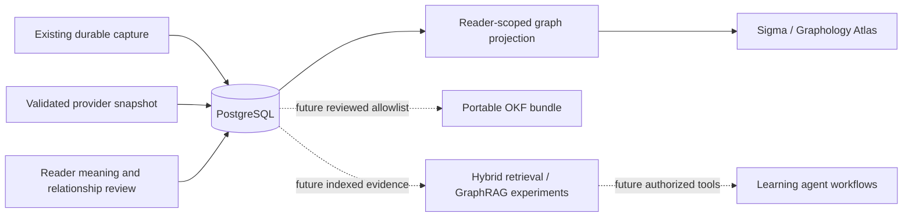

# Semantic Atlas: foundation and research plan

## Personal graph interpretation and connection review

The default view shows meanings and domain hubs. Word identity and collocation
nodes remain available through an optional layer. Small personal graphs label
their meanings by default. Topic membership is explained separately from
synonymy; node size and distance are not knowledge scores. Search opens the node
index on narrow screens. A summary, empty-state instructions, readable relationship
names and the suggestion queue provide starting points for exploration.

Domain projection normalizes Unicode case and whitespace, joining labels such as
Engineering and engineering without changing provider snapshots or stored facts.
This is conservative label reconciliation, not ontology alignment: semantic aliases
such as finance and economics remain separate. Acronym capitalization may be lost
in display labels. Domain assignments retain their original evidence on links.

`GET /atlas` includes a separate `suggestions` list, capped at 100. A deterministic
rule matches stored synonym/antonym strings to exact normalized lemmas in the
reader's visible vocabulary, with matching language and part of speech. Ambiguous
target lemmas are withheld. Suggestions are disabled when the sense snapshot is
truncated; only the existing bounded encounter window is examined. Missing hints,
inflections and uncertain matches produce no suggestions. This is a candidate
retrieval baseline, not an automatic sense-relation classifier or lexical import.

`POST /atlas/suggestions/{id}/review` accepts reviewed/rejected status and rebuilds
the candidate from owned evidence. The client cannot supply arbitrary endpoints.
Both decisions persist in the existing user-owned assertion table. Accepted links
appear on the graph; rejected links stay absent and are not suggested again.
Provider/model provenance and rule version are retained alongside reader review.
Stale or already reviewed proposals return 409. Readers can reject accepted links
from the inspector. Existing assertion review records current state, not a complete
edit history. No new schema migration or provider call is required.

Visible personal maps poll every 15 seconds and refresh on focus. Requests are
cancelled on collection change/unmount and overlapping polls are skipped. Identical
snapshots retain object identity to avoid restarting the layout; failed background
refreshes preserve the last graph and show an error. Changed graph snapshots can
restart layout settling. Demonstration data does not poll periodically.

### Controlled baseline checks

Synthetic mock fixtures expect two proposals after capturing mitigate, alleviate
and exacerbate: one synonym candidate and one antonym candidate. Tests verify the
two expected types, absence of automatic edges, acceptance, dismissal, persistence,
privacy isolation, ambiguous-target exclusion, and language/part-of-speech guards.
These are authored regression cases, not independent linguistic validation. A
larger human-adjudicated set of sense pairs, with held-out precision/recall and
abstention reporting, remains necessary before claiming semantic accuracy or
comparing an LLM classifier with this exact-match baseline.

Implemented scope: Atlas milestone 1 and an initial milestone 2 explorer. The
reading MVP, real/mock providers, immutable provider snapshots, sense selection,
existing tables and migration history are preserved. This is a local, single-reader
system. It is not yet a predictive model of language knowledge.

## Scientific motivation

A recorded unfamiliar word is evidence of an encounter, not a test of recall.
A chosen meaning records interpretation, not demonstrated comprehension or production.
The Atlas makes those distinctions visible while organizing lexical claims for
later evaluation. Semantic similarity, graph position and centrality must never
be silently promoted into synonymy, proficiency or prerequisite claims.

## Responsibilities

Storage, graph projection, rendering, retrieval, and agent memory have separate
responsibilities. No cloud service is required for this slice. Rendering the graph
does not query OpenAI, generate embeddings, or train a model.

## Ontology and identity

| Node | Identity / current implementation |
| --- | --- |
| Lexeme | Existing UUID + language + lemma; shown separately from senses. |
| WordSense | Existing UUID; definition + part-of-speech fingerprint. Distinct meanings never collapse solely because their labels match. |
| Domain | New `lexical_domains` table; multiple parent links in `domain_parents`. Provider labels are separate, unreviewed projected nodes with deterministic hashes. |
| Collocation | Projection from a provider's exact normalized phrase; language pair currently en→ru. It is a proposal, not corpus-verified phrase frequency. |
| ReadingOccurrence / ReadingSource | Existing private tables; visible in owned sense details, not duplicated in shared lexical storage or bulk graph context. |
| Concept / LearnerKnowledgeState | Future entities. Do not equate an English sense with a universal multilingual concept or initialize fictitious mastery states. |

The first domain label determines colour and the primary visual group. All domain
memberships remain available. This visual convention is not exclusive classification.
Language is retained on lexical nodes; imported multilingual concept alignment and
language-specific collocation identity require a later importer and migration.

| Edge | Endpoint types | Semantics |
| --- | --- | --- |
| HAS_SENSE | Lexeme → WordSense | Stored identity association, structural. |
| BELONGS_TO_DOMAIN | WordSense → Domain | Evidence-bearing classification; provider projections remain proposed. |
| SUBDOMAIN_OF | Domain → Domain | Stored taxonomy; never an algorithmically detected community. |
| PART_OF_COLLOCATION | WordSense → Collocation | Provider phrase suggestion, unreviewed. |
| SYNONYM_OF / ANTONYM_OF / RELATED_TO | WordSense ↔ WordSense | Explicit assertion with evidence; symmetric endpoints are canonicalized. |
| HYPERNYM_OF | WordSense → WordSense | Source is broader than target; directional. Inverse traversal does not reverse the assertion. |
| MORPHOLOGICALLY_RELATED_TO | WordSense ↔ WordSense | Explicit reader assertion; a proper lexeme-family model is later work. |

New `semantic_assertions` carry reader ownership, source/target FKs, constrained
kind/status, evidence, nullable confidence, provenance and timestamp. Existing
`semantic_relationships` are preserved and projected as legacy shared assertions.
Personal editorial judgments must not overwrite shared imported facts, which is
why a separate owned assertion table is introduced rather than repurposing the
legacy shared rows. Rejection retains the row. Full revision history is future work.

New `lexical_classifications` supports overlapping domain, register, frequency,
CEFR, concreteness, morphology, academic-use and collocation dimensions. Each
record includes evidence, source/version metadata, status and optional confidence.
The schema is present; no corpus measurements or CEFR values are fabricated.
There is no general classification editor or resource importer yet. Importers
must validate measurement units, language, corpus/version/license and domain DAG
acyclicity; the current FK/self-loop checks alone do not enforce a taxonomy DAG.

## Construction pipeline and API

1. Existing enrichment saves separate candidate sense IDs and provider metadata.
2. `GET /atlas` selects only senses attached to this reader's encounters. Default
   limit is 500 senses; maximum is 1,000. Lexeme, domain and collocation nodes are
   additional. At most 2,000 occurrence snapshots contribute proposed labels and
   counts. Truncation flags describe either boundary. Counts are within that window.
3. Deterministic IDs deduplicate projected labels. Subject-area and collocation
   suggestions become proposed edges; synonym strings do **not** become edges.
4. `GET /atlas/senses/{id}` checks reader visibility and returns up to 50 private
   encounters. It must never be used as a public knowledge export.
5. `POST /atlas/relationships` requires two owned candidate senses, an allowed
   type, and nonblank evidence. Symmetric reverse submissions reuse one assertion.
6. `POST /atlas/relationships/{id}/review` accepts reviewed/rejected only for an
   owned assertion. Reader review is not independent linguistic verification.
7. `GET /atlas/demo` returns the original deterministic v1 fixture: 480 synthetic
   sense specimens, six domains and 1,722 edges. Nothing is inserted into the DB.

Bounded sense queries and indexed associations are sufficient for this first
local slice. Labels, classifications and taxonomy projections need additional
quotas and cursor pagination before a large external corpus is imported.

## Visualization decisions

Sigma 3.0.2 is pinned for a stable WebGL integration; Graphology 0.26.0 owns graph
operations and ForceAtlas2 0.10.1 supplies a layout worker. Sigma 4 exists; a
separate migration should evaluate its changed rendering API. See the official
[Sigma repository](https://github.com/jacomyal/sigma.js) and
[Graphology ForceAtlas2 documentation](https://graphology.github.io/standard-library/layout-forceatlas2.html).

- Network runs a Barnes–Hut ForceAtlas2 worker for a bounded settling interval,
  then stops to avoid permanent jitter. Dragging stops the worker. Resources are
  killed on unmount and dataset/layout changes.
- Clusters uses deterministic spatial groups from domain labels. This is not
  community detection. Orbit lays out one/two-hop undirected neighborhoods.
- Reference-inspired black constellation styling uses curved, subdued coloured
  edges, small degree-scaled points, and soft hub/selection halos. Off/Key/All
  label modes control density. A lightweight Canvas overlay adds glow to WebGL
  rendering; it does not replace the graph with a decorative image.
- Search + the keyboard-accessible node list select and center nodes. Zoom/pan,
  reset, neighborhood inspection, and paths operate on the visible snapshot.
- Paths deliberately ignore direction for exploration and say so. They are not
  proofs of semantic entailment. Direction/type remain visible in edge details.
- Filters run locally; changing a filter does not issue another graph request.
  Automatic checks (15 seconds while visible) and Refresh pick up new vocabulary.
- Reduced motion disables the force worker and camera animation. WebGL failure
  leaves a searchable node list and inspector. No FPS guarantee is claimed.

Initial limits: layout switches currently rebuild the renderer rather than
interpolate between saved coordinates; no ambient animation, community detection,
timeline, continuous synchronization, learning-state/source/time filters, or
centrality-based recommendations. These should be separate measured iterations.

## Resource and infrastructure investigation (2026-10-13)

| Candidate | Role and decision |
| --- | --- |
| [WordNet](https://wordnet.princeton.edu/citing-wordnet) | Promising English sense/relation source. Preserve synset IDs, release, citations and the [distribution license](https://wordnet.princeton.edu/license-and-commercial-use). Align user senses through reviewed candidates; do not merge on spelling. Explicit derivational links are now bundled for optional word-family lookup; see [Word families](word-families.md). Full synset graph import and alignment to AI senses remain unimplemented. |
| [wordfreq](https://github.com/rspeer/wordfreq) | Multilingual lexical frequency estimates, not sense frequency or CEFR. Upstream describes the data as a snapshot through roughly 2021. Code and included data have different licensing/attribution requirements; preserve its packaged notices in any later integration. Not installed or redistributed here. |
| Corpus frequency / CEFR | Require a versioned, suitably licensed resource and explicit measurement scope. Frequency is not a calibrated difficulty scale; unknown is preferable to an invented CEFR label. |
| [FSRS](https://github.com/open-spaced-repetition/awesome-fsrs/wiki/The-Algorithm) | Difficulty, stability and retrievability are a candidate memory baseline once timestamped review outcomes exist. Do not feed passive encounters as successful recalls. No FSRS estimates shown now. |
| [pgvector](https://github.com/pgvector/pgvector) | Later optional PostgreSQL extension for vector candidates plus lexical retrieval. Store model/version/dimensions/content hash. Proximity proposes links; it does not establish their type. |
| [BigQuery Graph](https://docs.cloud.google.com/bigquery/docs/graph-overview) | Later analytical projection with graph-query support. Evaluate cost/benefit against local SQL; do not migrate private transactional memory merely to use a graph query language. |
| [OKF specification](https://github.com/GoogleCloudPlatform/open-knowledge-format/blob/main/SPEC.md) | Portable curated knowledge representation. Existing synthetic sample remains; real export needs a reviewed privacy allowlist and provenance/license validation. |
| [GraphRAG](https://microsoft.github.io/graphrag/) | Retrieval experiment, not the graph canvas. Compare against lexical and hybrid retrieval on the same annotated questions before adopting graph expansion or summarization. |
| [Google ADK memory](https://google.github.io/adk-docs/sessions/memory/) | Later orchestration/context services. Agent conversational memory is distinct from learner evidence and the lexical graph. Tools/MCP should wrap authorized, bounded operations rather than expose raw DB access. |

## Prediction and evaluation gates

The proposed learning observation record (milestone 3) contains user, sense,
timestamp, task type, prompt/version, response outcome, rubric/source, confidence,
and consent scope. Recognition, recall and productive usage remain distinguishable.
Never derive `understood` or `activated` solely from encounter or selection counts.

Before model adoption, compare:

| Experiment | Baseline → candidate | Evaluation |
| --- | --- | --- |
| Disambiguation / typed links | Majority sense / resource edges → LLM-assisted proposals | Blinded sense-pair annotations, precision by type, ambiguous cases and abstention coverage. Split by lemma/source to reduce leakage. |
| Forgetting | Fixed exponential decay → default FSRS → personalized fit | Temporal holdout, Brier score, log loss, reliability bins and uncertainty intervals. Separate recognition from recall and production. |
| Gaps | Capture counts → exposure-normalized rates | Observe reading volume/topic exposure and diagnostic sampling; missing exposure makes population-level gap claims unavailable. |
| Frontier / bridges | Frequency + stated interests → graph-aware ranking | Reader relevance labels, useful active usage, diversity and novelty. Centrality is a feature, not importance or prerequisite evidence. |
| Retrieval | Lexical → lexical + vector → bounded graph expansion | Recall@k, ranking quality, evidence correctness, latency, token cost; identical query set and privacy filters. |
| Layout / clustering | Domain groups → seeded community detection | Seed-to-seed stability and interpretability; never substitute community membership for linguistic taxonomy. |

Synthetic topology tests verify integrity and interaction, not semantic accuracy.
There is no labeled benchmark or demonstrated predictive improvement yet.
Future observability should record latency/error/model-version aggregates without
logging personal reading sentences, keys, or raw provider bodies.
